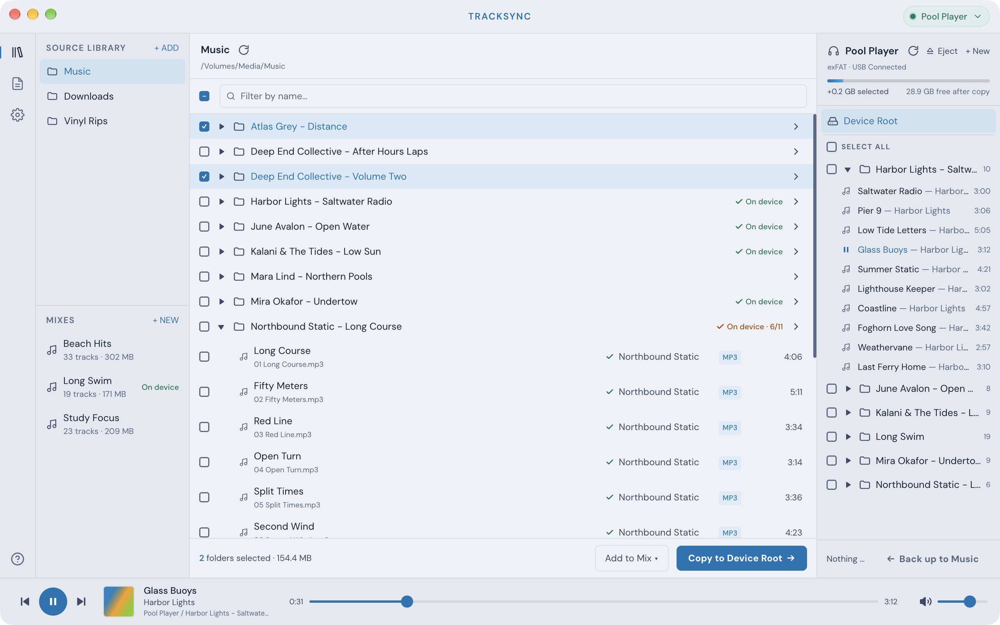

# TrackSync

A macOS app for putting music on MP3 players that show up as a USB drive.

TrackSync started as a better way to load the Shokz OpenSwim Pro. It now works with any player that mounts in Finder as a mass-storage drive: keep a library of source folders on your Mac, browse the player's folders side by side, and copy albums, tracks and reusable mixes across.

This repository hosts release binaries only. Source code is not public.

## Download

Get the latest `.dmg` from [Releases](https://github.com/appsnitato/tracksync/releases/latest).

## Which players work

If your player appears as a drive in Finder when you plug it in, TrackSync can manage it. Examples:

- **Swim headphones:** Shokz OpenSwim Pro (tested reference device), Shokz OpenSwim
- **Clip and sport players:** SanDisk Clip Jam, SanDisk Clip Sport
- **Budget MP3 players:** AGPTEK, Ruizu, Mechen and similar no-brand players
- **Walkmans:** Sony Walkman NW-A and NW-E series, in USB mass-storage mode
- **Plain storage:** USB sticks and SD cards for car stereos or speakers

Only the OpenSwim Pro is tested on real hardware. Other players are supported on a best-effort basis; if yours misbehaves, please [open an issue](https://github.com/appsnitato/tracksync/issues).

**Not supported:**

- Players that use MTP rather than a drive, such as most Android phones and some newer Walkmans
- iPods running Apple's firmware, which read music from their own database, not from folders

## Audio formats

`.mp3`, `.flac`, `.wav`, `.aac`, `.m4a`, `.ape`, `.wma`. Whether a format plays depends on your player.
